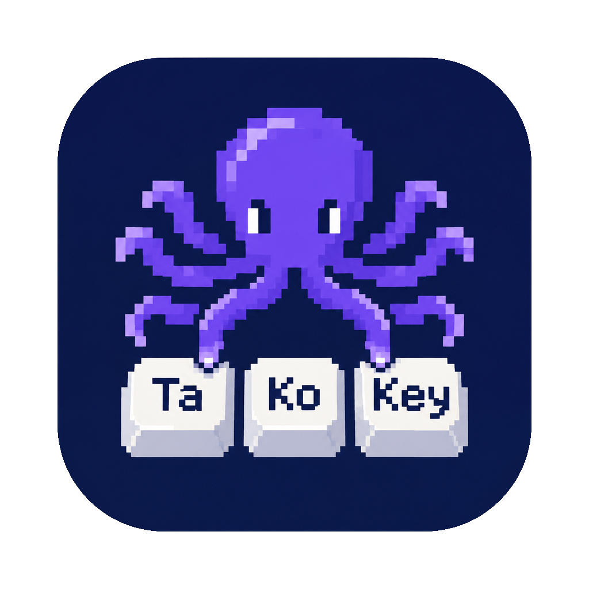

# TakoKey: language switcher for Mac

Website: [takokey.potapenko.ai](https://takokey.potapenko.ai/)

I have 3+ languages on my Mac and use all of them every day. Switching with Ctrl+Space, the default macOS way, was too slow. I had to go through the list to find the one I needed. Years ago on Windows, I could set a key combination for each language, like Ctrl+Shift+1, 2, 3. Now I have the same on my Mac, and I'm happy to share it with you.

TakoKey is a language switcher for Mac. It gives each input language its own keyboard shortcut. When you push the shortcut, your Mac changes to that language immediately. You can set up any combination you like for any language your Mac has. It is a free, open-source menu-bar app and needs no Accessibility permission.

It works with Chinese, Japanese, Korean and Vietnamese (CJKV) input methods: Pinyin, Wubi, Zhuyin, Cangjie, Cantonese, Japanese Romaji and Kana, Korean, Vietnamese Telex and VNI. These can stay active after you switch away. TakoKey fixes that with [routes](#routes).

> *Tako* (タコ) is Japanese for octopus. **ta-ko-key** - the same rhythm as **Cmd-Shift-1**.  


## Requirements

- A Mac with Apple silicon or Intel. Intel Macs are not tested yet. If something doesn't work, [open an issue](../../issues).
- macOS 13 Ventura or later. Tested on: 
    - macOS 26.6.2
    - macOS 26.7.1
    - macOS Golden Gate 27.0.1.
    - macOS Golden Gate 27.2.1

## Install

**With Homebrew:**

```
brew install bvpotapenko/tap/takokey
open $(brew --prefix)/opt/takokey/TakoKey.app
```

To update: menu-bar icon > **Check for Updates…** > **Copy Command**, then paste it in Terminal. It updates and restarts TakoKey.

**Without Homebrew:**

paste this in Terminal ([read the script](https://github.com/bvpotapenko/takokey/blob/main/install.sh)):

```
curl -fsSL https://raw.githubusercontent.com/bvpotapenko/takokey/main/install.sh | bash
```

Run it again to update.  
Or download `TakoKey.dmg` from [Releases](https://github.com/bvpotapenko/takokey/releases) and move TakoKey to Applications.  
If macOS stops it, go to **System Settings > Privacy & Security** and click **Open Anyway**.


## Build from source

```bash
xcode-select --install
git clone https://github.com/bvpotapenko/takokey.git && cd takokey
chmod +x build.sh && ./build.sh
pkill -x TakoKey; rm -rf /Applications/TakoKey.app
cp -R build/dmg/TakoKey.app /Applications/ && open /Applications/TakoKey.app
```

## Settings

Click the menu-bar icon > **Settings…**. Changes are saved right away. Press **Esc** to close.

- Each language you have is in the list. Click its shortcut, then push the new keys. **Delete** removes the shortcut. **Esc** cancels.
- Use ⌃, ⌥, or ⌘. You can also add ⇧. Keys: 0–9, A–Z.
- New settings use ⇧⌘ with 1, 2, 7, 8, 9 and 0. They skip 3–6 because macOS takes screenshots with them.
- You can also take over a macOS shortcut, like ⇧⌘3. While TakoKey runs, it changes the language instead. Settings shows a warning below it.
- If another language or macOS also uses a shortcut, Settings shows a warning below it. TakoKey cannot see the shortcuts of other apps.
- You cannot use `fn` (🌐). To use the 🌐 key, change it to Control in **System Settings > Keyboard > Keyboard Shortcuts > Modifier Keys**.
- Did you add a language? It is in the list. Give it a shortcut. To start again from your current languages, click **Reset to Defaults**. TakoKey keeps the old file as `takokey.txt.bak`.
- To start TakoKey when you log in, turn on **Start TakoKey at login** in Settings.

TakoKey keeps your settings in `~/.config/takokey.txt`. You can also edit this file. Then quit and start TakoKey again. If a line has an error, the icon changes to a warning triangle. The menu shows the line.

## Routes

Chinese, Japanese, Korean and Vietnamese input methods can stay active after you change the language. The menu bar shows the new language, but you type English. A route prevents this: TakoKey changes to English first, and then to your language.

TakoKey adds routes for every CJKV input method in macOS: Chinese (Pinyin, Shuangpin, Wubi, Stroke, Zhuyin, Cangjie, Sucheng), Cantonese, Japanese (Romaji and Kana typing, all modes), Korean (2-Set, 3-Set, Romaja) and Vietnamese (Telex, Simple Telex, VNI, VIQR). It also adds a route for any other input method you have when TakoKey first starts. To change them, go to **Settings… > Routes**.

Does a different language have this problem? [Open an issue](../../issues).

## License

[GNU GPL v3](LICENSE)

© 2026 Bogdan Potapenko, https://potapenko.ai
